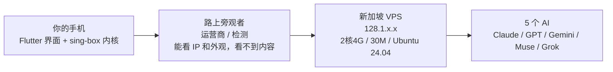
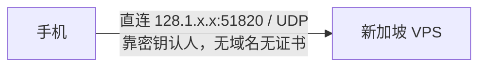
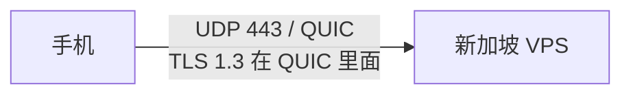
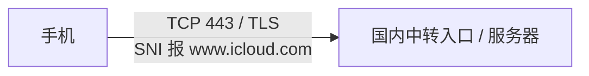
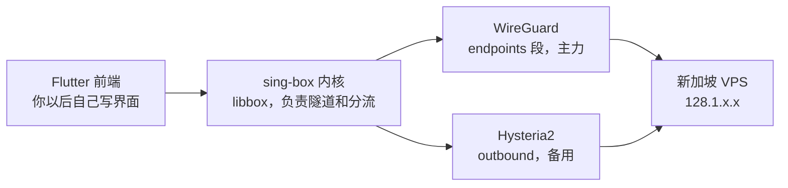

# VPN 协议图文说明

> 同一台手机、同一台服务器，区别只在路上穿什么衣服
> 本目录脚本：[install-wireguard.sh](./install-wireguard.sh)（WireGuard 服务端一键安装，UDP 51820）

## 一、总图：手机怎么连到新加坡



```text
你的手机 ──加密隧道──> 新加坡 VPS ──> 5 个 AI
Flutter+sing-box       128.1.x.x   出口 IP 变成新加坡
```

要点：

- VPS 是切出来的一台虚拟小电脑，有独立公网 IP、能拿 root、24 小时开机
- VPN 是在 VPS 上搭的一条加密隧道，连上后对外显示的 IP 就是新加坡
- 旁观者永远看不到内容，只能看外观；协议的区别就是外观和速度

## 二、三条主路对比

### 1. WireGuard — 直连，不穿西装（你的主力）



- 加密：ChaCha20，开销最小，手机最省电
- 速度 / 延迟：第一档，基本等于裸连新加坡 60–80ms，30M 能跑满
- 缺点：握手特征一眼能认出是 WireGuard，走 UDP，被掐 UDP 时第一个受影响
- 适合：自用 1–2 台设备，没人盯单个 IP，不需要伪装

### 2. Hysteria2 — 穿 HTTP/3 西装（你的备用）



- QUIC 是新版网页协议 HTTP/3 的底座，旁观者看着像在刷网页视频
- 晚高峰丢包时靠暴力拥塞控制反而更快，专治跨境烂线路
- 代价：手机客户端更吃 CPU、更耗电；服务端也吃得多一点，但云服务器插电、30M 流量下够不上瓶颈
- 适合：WireGuard 被限速 / 连不上时顶上

### 3. Trojan — 穿真 HTTPS 西装（快柠檬在用）



- 握手时在 SNI 里报苹果 iCloud 的假名，流量和真浏览网站一模一样，证书不校验（skip-cert-verify）
- 快柠檬实证：Flutter 壳 + sing-box 核 + Trojan over TLS，入口是国内中转 IP + 高位端口
- 更正：实测其入口无回落网页返回，未证实有真回落站；伪装只在 SNI + TLS 外观这一层
- 缺点：TCP + TLS 双层拖速度、延迟更高、丢包时队头阻塞，还要养域名证书那一套
- 适合：卖给公众的服务，用户量大、怕节点 IP 被识别被封，被迫穿西装活下去

## 三、一张表看全

| 协议 | 走法 | 外观 | 速度 | 手机耗电 | 伪装 | 你用不用 |
| --- | --- | --- | --- | --- | --- | --- |
| WireGuard | UDP 直连 IP:51820 | 一眼可认 | 最快 | 最省 | 无 | 主力 |
| Hysteria2 | UDP 443 / QUIC | 像 HTTP/3 网页 | 快，丢包时最强 | 较高 | 中 | 备用 |
| TUIC | UDP / QUIC | 像 HTTP/3 网页 | 快 | 中 | 中 | 可选同门 |
| Trojan | TCP 443 / TLS | 像真 HTTPS 网站 | 中，被 TLS 拖 | 中 | 强 | 不用 |
| VLESS+Reality | TCP / TLS | 借真大站指纹 | 较快 | 中 | 最强 | 卖服务才用 |
| Shadowsocks | TCP/UDP 轻量转发 | 本身不伪装 | 快 | 省 | 无 | 不用 |
| VMess | TCP/UDP | 老 V2Ray 协议 | 中 | 中 | 中 | 已退潮 |
| OpenVPN / IKEv2 | TCP/UDP 或 IPsec | 企业 VPN 外观 | 慢 / 中 | 高 / 中 | 无 | 新装不选 |

## 四、其他主流协议归位

- 真 VPN 家族：OpenVPN、IKEv2/IPsec；PPTP / L2TP 已淘汰、不安全
- HTTPS 伪装家族：VLESS+Reality（现任第一，借真大站 TLS 指纹、不用自备证书）、Trojan（上一代）、VMess（前身，已被 VLESS 取代）、AnyTLS（2025 新出，sing-box 力推，还在涨）
- QUIC 加速家族：Hysteria2、TUIC，都是 UDP + TLS 1.3，治丢包
- 轻量代理家族：Shadowsocks（SS2022）、SOCKS5 / HTTP 代理（无加密，不能单独当 VPN）

热度排序（2026）：

- 卖服务：VLESS+Reality > Hysteria2 / TUIC > Shadowsocks > Trojan > VMess
- 自用：WireGuard > 其他所有

## 五、你的定版



- sing-box 里 WireGuard 叫 endpoint、写在 `endpoints` 段，不叫 outbound；和快柠檬调 Trojan 是同一个位置、换个协议段
- 同一个前端就能一键切换：平时 WireGuard，卡了切 Hysteria2
- 部署配套：优刻得控制台防火墙须放行 UDP 51820（现有 Web 推荐只放了 22 / 80 / 443）
- 服务端脚本就在本目录：`install-wireguard.sh`，装服务端 + 生成手机客户端配置与二维码
