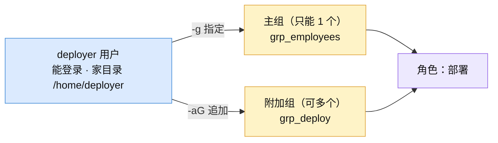
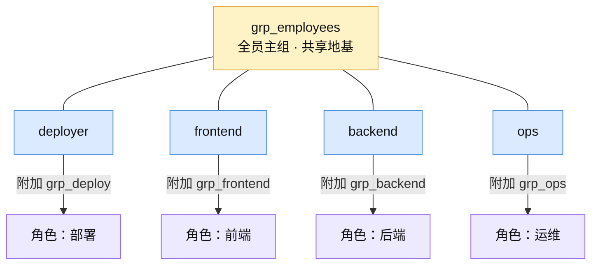
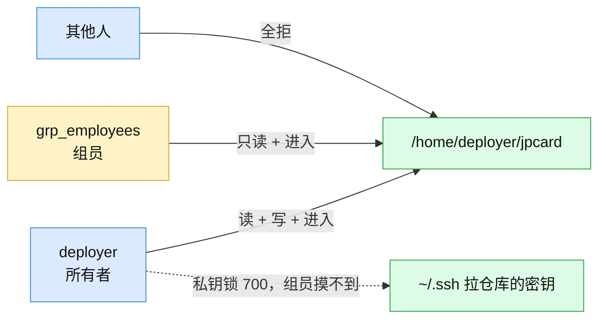
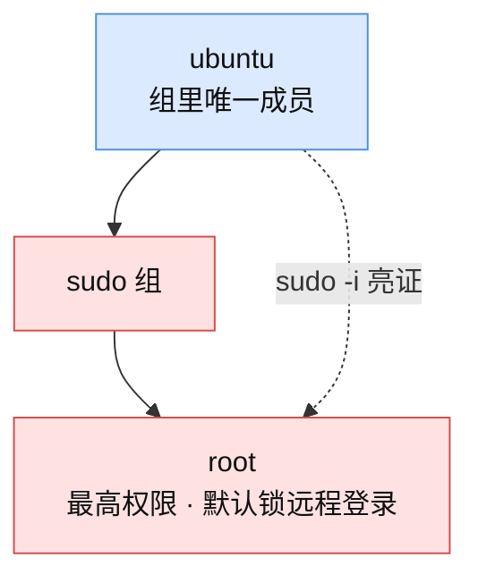

# jpcard 服务器初始化：用户、组与角色图文说明

配套脚本：同目录 `jpcard-server-init.sh`
用途：新服务器初始化——建组、建 deployer 用户、配 Git 与 GitHub SSH 密钥、拉取 Kenguba/jpcard 仓库、设置项目共享权限

图为 Mermaid 版，在 GitHub 打开自动渲染成图形；每张图下方附 ASCII 版，纯文本打开也能看

## 一、先分清三种东西

| 概念 | 是什么 | 例子 |
|---|---|---|
| 用户 User | 能登录的账号，是「人」 | deployer、ubuntu |
| 组 Group | 贴在人身上的标签，是「圈子」，不能登录 | grp_ 开头的 5 个 |
| 角色 Role | 不是独立对象，是「用户 + 身上的组」组合出的职能 | 部署、前端、后端、运维 |

grp 只是英文 group 的缩写前缀，一眼区分谁是组、谁是人；Linux 本身不认前缀

## 二、拿 deployer 解剖



ASCII 版：

```
deployer            ← 用户，能登录，有家目录 /home/deployer
├ 主组（只能 1 个）：grp_employees
└ 附加组（可多个）：grp_deploy
```

deployer（人）＋ grp_deploy（标签）＝ 扮演「部署」角色
所以 deployer 本身不是角色，它是人；角色是它和组拼出来的

主组与附加组的区别：

- 主组：useradd 时用 `-g` 指定，一个用户只能有一个；决定他新建文件默认归哪个组
- 附加组：用 `usermod -aG` 追加，一个用户可以有很多个；是角色标签

## 三、全员结构：一个地基组 + 四张角色标签



ASCII 版：

```
grp_employees ← 全员主组（共享地基）
├── deployer（主组）+ 附加 grp_deploy  → 部署
├── frontend（主组）+ 附加 grp_frontend → 前端
├── backend （主组）+ 附加 grp_backend  → 后端
└── ops     （主组）+ 附加 grp_ops      → 运维
```

注意：脚本只真正创建 deployer 这一个用户；frontend、backend、ops 三个用户脚本不建，只先建好对应的组占位，以后要用人时再建用户、贴标签

## 四、这套组落到 jpcard 项目上的权限



项目目录 `/home/deployer/jpcard`：

| 对象 | 权限 |
|---|---|
| deployer（所有者） | 读 + 写 + 进入 |
| grp_employees（组员） | 只读 + 进入，不可写、不可删 |
| 其他人 | 全拒 |

咬合细节：

- 项目文件所属组统一刷成 grp_employees，目录带 setgid，新建文件自动继承这个组
- `/home/deployer` 给组 750，组员只能「穿过」去项目，进不了别的目录
- 例外隔离：deployer 的 `~/.ssh` 锁 700、私钥 600，组员能进项目，摸不到拉仓库的私钥

## 五、另一层：系统管理权（与上面的组无关）



ASCII 版：

```
root 最高权限（默认锁远程登录）
└ sudo 组：只有 ubuntu → sudo 一下就是 root
```

两个平面互不干扰：

- ubuntu 管系统（装软件、建用户、改配置）
- deployer 管项目（改代码、拉仓库）
- grp_ 这套组没有任何一个进 sudo 组，这是故意的分工

新建任何用户出厂都是白板普通用户：权限全靠 root 往他身上挂组——挂员工组能看项目，挂 sudo 组等于发 root 通行证

## 六、脚本怎么跑

1. 以 root 运行：`sudo bash jpcard-server-init.sh`（非 root 运行会跳过所有系统级操作）
2. 每个修改动作执行前都先显示完整命令，只有输入小写 `y` 才执行，其他输入一律跳过
3. 已存在/已配置的项目用红色提示，不重复执行
4. 分两遍跑完：
   - 第一遍：建组、建 deployer、配 Git、生成 deployer 的 RSA 公钥后停下，并打印公钥
   - 把公钥加到 GitHub 仓库 Kenguba/jpcard 的 Settings → Deploy keys（只读即可）
   - 第二遍：验证 GitHub SSH 通过后，自动 clone/pull 仓库并配置项目权限
5. 脚本末尾附了一份命令行速查总结（用户/组/权限命令全集），只作说明，不会被执行
